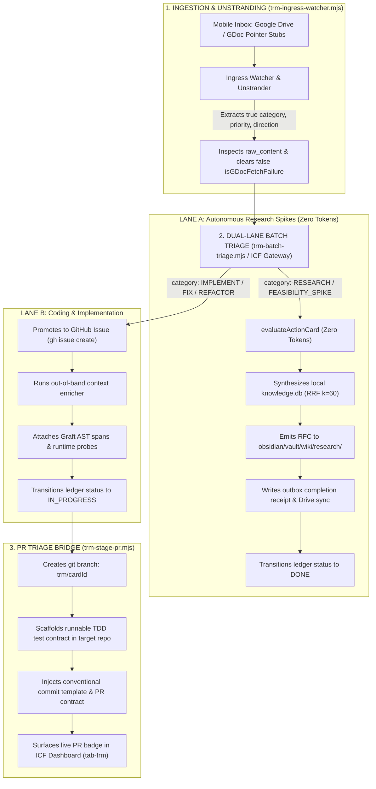

# TRM mobile inbox triage and PR staging pipeline

**Type:** Architecture, Operational Pipeline  
**Domain:** icf, trm, git-workflows  
**Status:** Active  
**Last Updated:** 2026-10-19

---

The Topic Research Mining (TRM) mobile inbox triage pipeline processes inbound action items from Google Drive through autonomous research spikes and pull request staging.

Mermaid source...

## Definition

The TRM mobile inbox triage system connects mobile thoughts, voice memos, and quick capture documents to automated execution lanes. The pipeline unstrands raw document pointers, routes research items to autonomous zero-token local spikes, and stages verified coding contracts into topic branches with TDD test files.

## Architecture and lifecycle

1. **Ingestion and unstranding:** `scripts/trm-ingress-watcher.mjs` extracts substantive intent from `.gdoc` files, resolves target repositories, and stages cards into `.harness/tasks/pending/`.
2. **Dual-lane batch triage:** `scripts/trm-batch-triage.mjs` and the ICF Gateway partition tasks into Lane A and Lane B.
3. **Autonomous research spikes (Lane A):** Research tasks run through `evaluateActionCard` with hybrid reciprocal rank fusion ($k=60$) over `.kb_cache/knowledge.db`, producing RFC notes and outbox receipts.
4. **Coding and implementation (Lane B):** Coding tasks generate GitHub issues with out-of-band Graft AST context packs.
5. **PR triage bridge:** `scripts/trm-stage-pr.mjs` branches the target repository (`trm/<cardId>`), scaffolds a runnable test contract (`tests/trm-<cardId>.test.mjs`), and reports branch telemetry to Iron Command Forge.

## Related concepts

- [[kb-sync/concepts/trm-closed-loop-research|TRM Closed Loop Research]]
- [[kb-sync/concepts/local-context-cache|Local SQLite Context Cache]]
